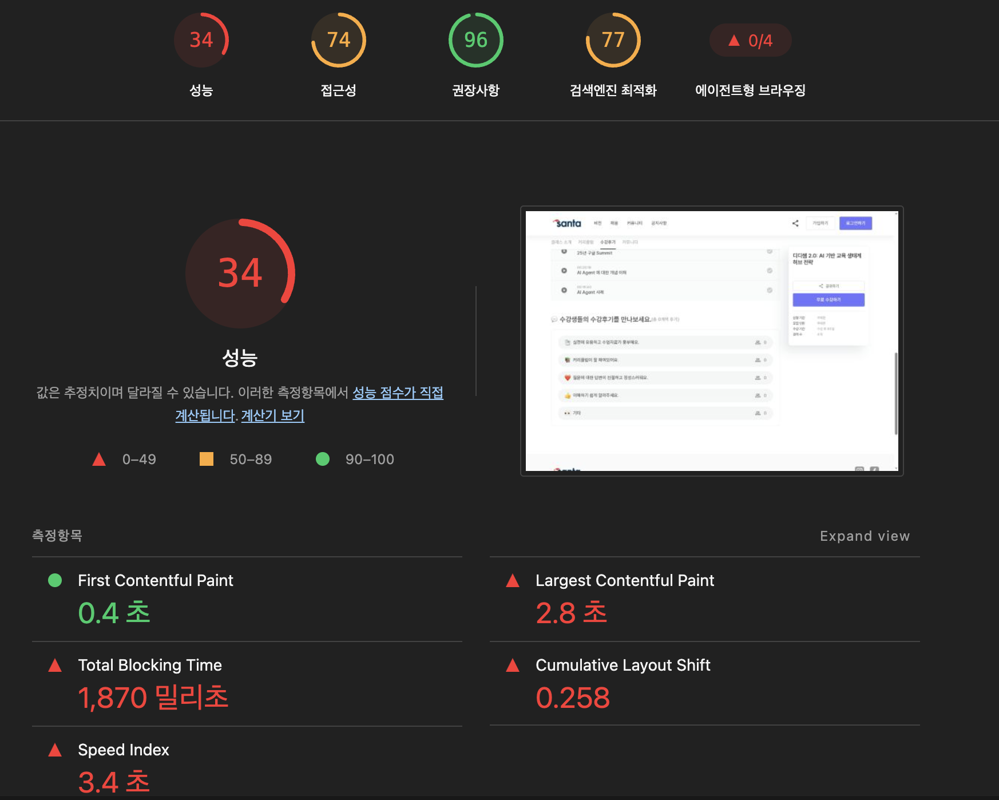
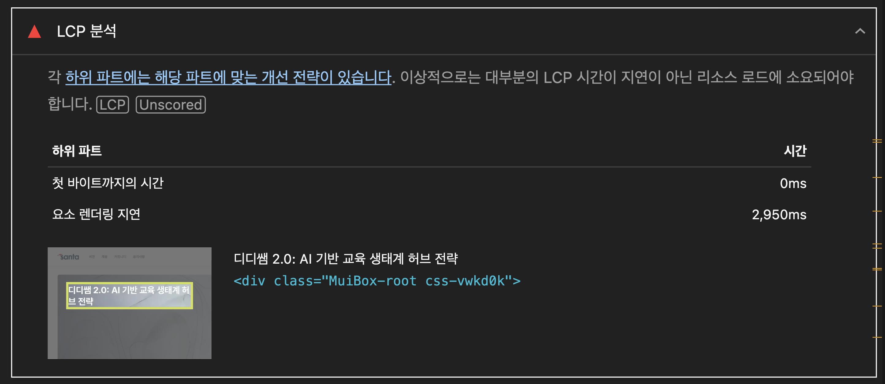
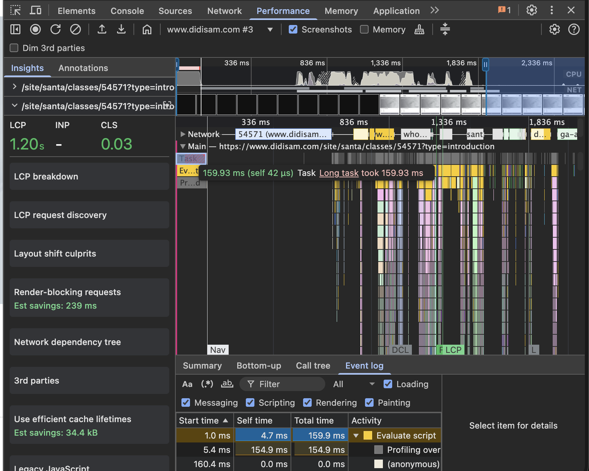
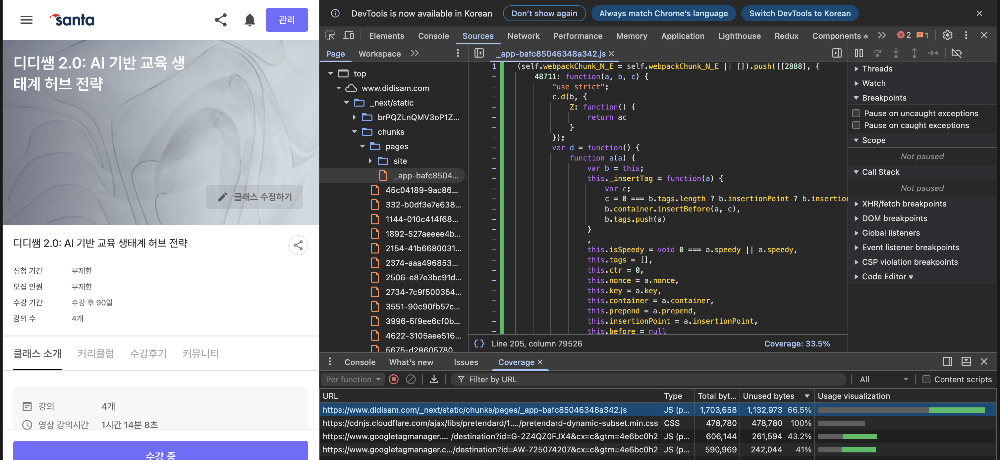
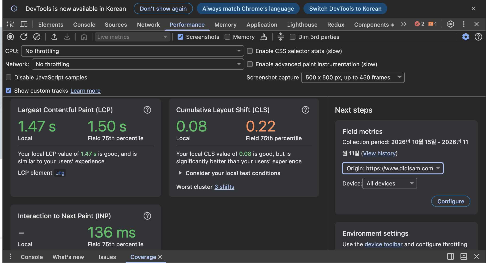
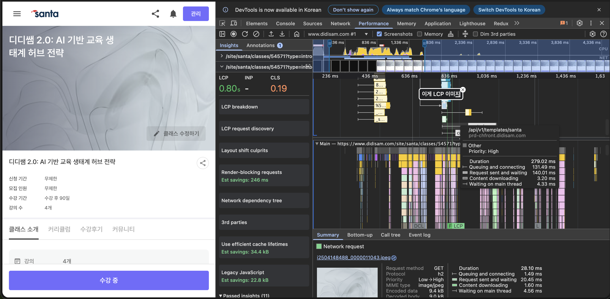
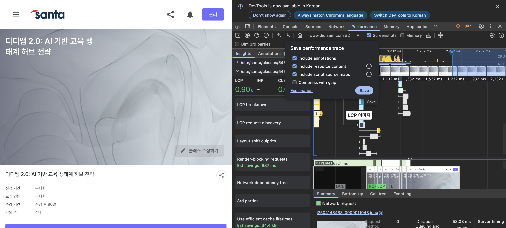
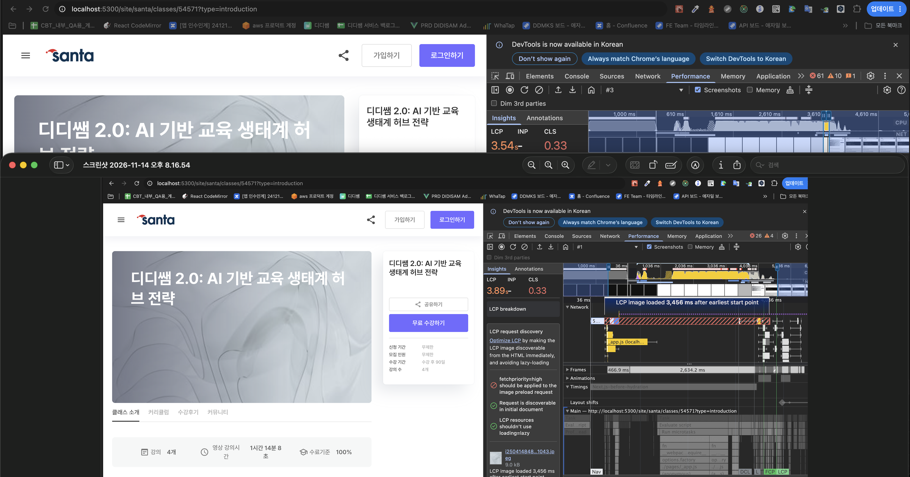

프론트엔드 성능 최적화 한번 공부해봅시다! <br/>
https://javascript.plainenglish.io/frontend-performance-optimization-a-practical-guide-to-faster-web-pages-c7a8d34fdbb5
이 페이지를 보면서 공부했습니다!

{/* truncate */}

### 프론트엔드 성능 최적화 전략 첫번째

> 모든 것을 빠르게 x, 사용자가 필요로 하는 것들 먼저 불러오고 실행하고 렌더링하기

### 1. 최적화 전에 측정부터!

유용한 측정 도구

- Lighthouse

  
  

- Chrome DevTools Network panel and waterfall
  - 개발자도구의 네트워크 탭
- Performance panel for long tasks and main-thread activity
  - performance 패널의 빨간색 막대 부분이 long tasks이다. 마우스 호버하고 클릭해보았다.
    
- JavaScript Coverage to identify code that is loaded but unused
  - 커버리지 탭에서 사용하지 않는 css, js를 확인할 수 있다
    
- Core Web Vitals, particularly LCP, CLS and INP
  - LCP(Largest Contentful Paint) : 가장 큰 콘텐츠가 화면에 보이기까지의 시간, 권장 기준 2.5s 이하
  - CLS(Cumulative Layout Shift) : 예기치 않은 레이아웃 이동의 누적량, 권장기준 0.1 이하
  - INP(Interaction to Next Paint) : 사용자 상호작용 후 다음 페인트까지의 지연, 권장기준 200ms 이하
  - next step 설정하면 실제 사용자들 환경에서는 어떻게 뜨는 지도 확인할 수 있다.
    실제 사용자들 환경이 좀 더 안 좋은 걸 확인할 수 있다.
    (숫자 2개 중 오른쪽 위치한 숫자)
    
- Real-user monitoring (RUM) for production data
  - 운영에 접속한 실제 사용자가 어떤 성능을 경험했는지 볼 때
  - sentry와 같은 타사 스크립트 삽입하여 확인 가능

https://www.didisam.com/site/santa/classes/54571?type=introduction
여기서 한번씩 해보았다
하면서 알게된 소소한 팁이 있는데
performance 분석에 주석을 달 수도 있고 연관있는 항목을 연결해놓을 수 있다.
이렇게 분석한 performance 결과를 파일로 팀원에게 전달할 수도 있다.

주석은 달길 원하는 것에 더블클릭이나 우클릭의 Label entry를 통해 달 수 있다
주석은 '이게 LCP 이미지'라고 달아보았다.


그리고 상단의 다운로드 아이콘 클릭(Save performance trace) 후 Compress with gzip 체크해제 후 저장하고
동료에게 전달하면 동료도 해당 파일 업로드를 통해 주석이랑 연결된 항목을 바로 확인해볼 수 있다.
퍼포먼스 탭에 파일을 드래그하거나 업로드하면 확인할 수 있다.


### 2. AI를 활용한 성능 데이터 분석

> Lighthouse 보고서, Chrome 개발자 도구 추적, 네트워크 워터폴, 성능 프로파일 또는 내보낸 웹 바이탈 데이터와 같은 성능 관련 자료를 AI 도구에 제공
> -> 결과를 요약, 패턴을 식별, 관련 문제를 연결, 심층 조사가 필요한 영역을 강조 표시하는 데 도움을 줄 수 있다.
> AI 기반 분석을 통해 해당 경고를 애플리케이션 구조와 연결할 수 있다.

사실 AI가 진짜 좋은 거 같다.
위에서 performance의 기능 숙지를 위해 유튜브도 보고 web.dev 페이지 설명도 보면서
시간을 많이 썼지만 조금 친밀해진 느낌만 들 뿐
이걸 어떻게 분석해서 실무에서 개선하는 데 쓰지? 진짜 잘 모르겠다 했는데
돌린 걸 ai에게 전달하니
이게 문제고 저게 문제고 매우 자세히 잘 말해주었다.
결과를 같이 첨부하기엔 회사 걸로 돌려본 거라 다들 직접 돌려보시길 추천한다.<br/>
(조언도 해준다...친절한 녀석...<br/>
"처음 그래프를 읽을 때는 LCP 표시 → 해당 이미지 요청의 시작 위치 → 그 앞의 API → 같은 요청의 반복 여부 → 같은 시점의 Main 작업 순서로 따라가면 이해하기 쉽습니다.")

보다보니 lighthouse가 모든 페이지를 분석해주는 게 아니라 한 페이지씩만 분석해주다 보니
이걸 자동화한 사람도 있더라.
한번 따라해보면 좋을 거 같아서 첨부해본다.
https://velog.io/@carloskim/%EB%88%84%EA%B0%80-%EC%9A%94%EC%A6%98-lighthouse-%EB%85%B8%EA%B0%80%EB%8B%A4-%ED%95%98%EB%83%90

### 3. 이미지는 중요한 것만 우선시

- 이미지 지연 로딩이 중요한 게 아니라 어떤 이미지에 우선순위 둘 지 결정하는 것
- LCP(Largest Contentful Paint) 이미지 - 중요 우선순위!

  - LCP는 사용자가 처음 페이지로 이동한 시점을 기준으로 표시 영역에 표시되는
    가장 큰 이미지 또는 텍스트 블록의 렌더링 시간을 보고한다.
    모든 콘텐츠가 화면에 그려질 때 측정하는 FCP와 다르게
    기본 콘텐츠가 페인트 될 때 측정된다.

    - loading vs fetchPriority
      - loading: 타이밍 제어
        - loading="eager" 로딩 지연 x, LCP 이미지에 사용
        - loading="lazy" 로딩 지연, 화면 밖 이미지
          <br />
          <br />
      - fetchPriority: 중요도
        - fetchPriority="high" LCP 이미지에 사용
        - fetchPriority="low" 중요도 낮아 우선순위 낮출 때 사용

    마침 해당 페이지에 fetchPriority="high"를 적용할 이미지가 있어서 적용해보았다.
    0.35s 정도 빨라진 걸 확인할 수 있다.
    

### 4. LCP: 활주로 비우기

- 모든 콘텐츠가 화면에 그려질 때 측정하는 FCP와 다르게
  기본 콘텐츠가 페인트 될 때 측정된다.

사용자가 주요 콘텐츠를 보기 전에 이 리소스가 먼저 제공되어야 하는 지 확인 필요!
아니라면 연기할 방법을 찾기!

### 5. 타사 코드: 사용자 경험을 해치지 않고 지연시키기

클라이언트 전용 동적 가져오기 window.load와 유휴 스케줄링을 결합하여 이 패턴을 구현할 수 있습니다.

```
 window.addEventListener ( "load" , () => { requestIdleCallback (loadChat, { timeout : 5000 , } ); } ) ;
```

혼합전략도 가능

정상 경로:
페이지 → 로드 → 대기 → 채팅
사용자가
페이지 초반을 클릭한 후 → 클릭 → 바로 채팅 시작

### 6. iframe: 별도의 문서가 페이지를 가리지 않도록 하세요

### 7. JavaScript: 오픈소스가 아니면 배포하지 마세요

### 8. CLS: 콘텐츠 도착 전 공간 확보

    - CLS의 일반적인 발생원
        - hydration 후 레이아웃 변경
        - 예측 가능한 크기가 없는 이미지
        - 예약된 공간 없이 나타나는 iframe
        - 최종 레이아웃과 일치하지 않는 로딩 상태
        - 기존 레이아웃에 비동기 콘텐츠를 삽입하는 방법

### 9. 효과가 없는 일반적인 접근 방식

### 10. 접근성 저하 없는 성능

### 11. 결과를 측정하십시오

### 12. 실용적인 프런트엔드 성능 점검 목록

    #### 이미지

- LCP 자원에 우선권 부여
- 모든 이미지에 최우선 순위를 부여 x
- 뷰포트에 적합한 크기의 이미지를 제공합니다.
- 화면 밖 이미지를 지연 로드합니다.(슬라이드 이미지도 포함)

#### 타사 코드

- 가능하면 타사 스크립트가 중요한 렌더링 경로에 포함되지 않도록 하십시오.
- 모든 것을 즉시 로드하는 것보다 나중에 로드(사용자가 바로 사용해야한다면 즉시 로드)

#### 자바스크립트

- 사용자가 우선순위 낮고, 비용이 많이 드는 UI 요소를 동적으로 가져오기
- 상호작용 기반 애니메이션을 선호
- 비동기 콘텐츠가 도착하기 전에 공간을 확보
- 골격 형상이 최종 UI와 일치
- 서버와 클라이언트의 렌더링 결정을 일관되게
- 콘텐츠를 불필요하게 다시 마운트 x

#### 측정

- 최적화하기 전에 측정
- 추측에 기반한 최적화 대신 실제 병목 현상을 파악
- 한 번에 의미 있는 한 가지씩 변경
- 결과를 다시 한번 검증
- 가능하면 실험실 측정값과 실제 사용자 데이터를 모두 사용

> 위에서 확인했을 때 우리 프로젝트에 사용하지 않는 js, css 등이 있는데 함부로 지울 수는 없어서
> 추가적인 확인이 필요할 거 같다. <br/>
> api 중복 호출 등 부분들을 해결해서 성능을 높여볼 계획이다!<br/>
> 좀 잘 써보고 싶어서 이것저것 해봤는데 이게 글로 써서 나누려고 하니까 어려웠다.<br/>
> 꾸준히 쓰다보면 이것도 다른 사람들이 보기에도 유익한 글을 쓸 수 있지 않을까 희망해본다!

참고 <br/>

- https://developer.chrome.com/docs/devtools/performance/overview?hl=ko<br/>
  -> performance 주석, 링크 팁을 얻음! <br/>
- https://www.youtube.com/watch?v=cAIo4dEEPuc&t=2078s
- https://www.inflearn.com/course/%EC%95%84%EB%8A%94%EB%A7%8C%ED%81%BC-%EB%B3%B4%EC%9D%B4%EB%8A%94-%ED%81%AC%EB%A1%AC%EA%B0%9C%EB%B0%9C%EC%9E%90-%EB%8F%84%EA%B5%AC?cid=331168&inst=450c276b&utm_campaign=inflearn_%ED%8A%B8%EB%9E%98%ED%94%BD_promotion-link&utm_medium=referral&utm_source=instructor
- https://www.inflearn.com/course/%EC%9B%B9-%EC%84%B1%EB%8A%A5-%EC%B5%9C%EC%A0%81%ED%99%94-%EB%A6%AC%EC%95%A1%ED%8A%B8-1/dashboard?cid=324686
