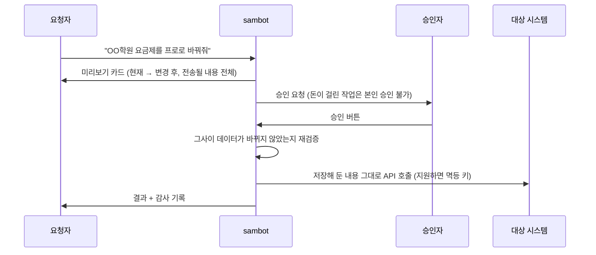
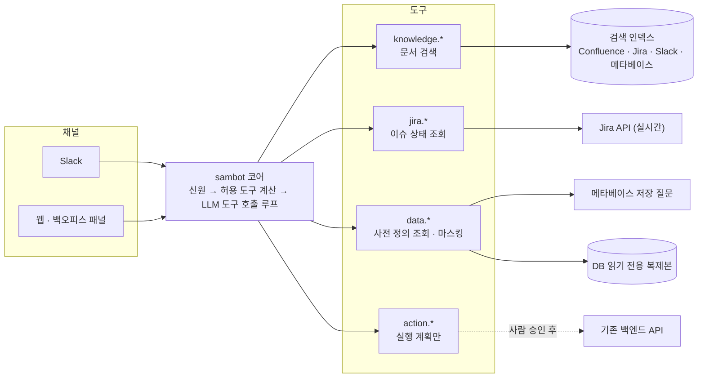
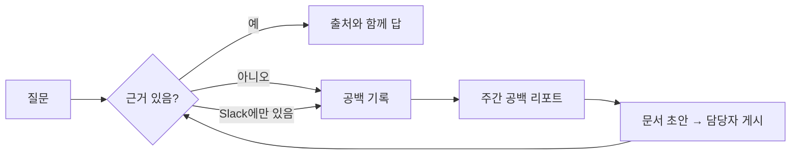

글. [mchan](/blog/authors/hanmyungchan)

"수강률이 30%를 넘으면 환불이 어떻게 되나요?" "OO학원은 어떤 요금제고, 결제는 언제 됐나요?" 이런 질문이 매주 Slack에 올라오고, 답은 대개 같은 몇 사람이 단다.

답이 어딘가에 없는 것도 아니다. Confluence 문서나 지난달 Slack 스레드를 뒤지면 대부분 나온다. 찾기가 어려울 뿐이다. 직원용 챗봇 sambot은 이 문제에서 출발했다.

이 글은 sambot을 만들기 전에 정한 것들, 그중에서도 LLM에게 맡기지 않기로 한 일들을 정리한 것이다. 아직 설계 단계라 실제로 돌려 본 결과는 없다. 글에 나오는 Slack·메타베이스의 권한 동작은 공식 문서와 대조해 정리한 것이고, 구현하면서 직접 검증할 예정이다.

:::tip[세 줄 요약]
- LLM은 질문을 해석하고 결과를 설명하는 일만 한다. 조회·계산·판정·실행은 코드가 한다.
- 권한은 프롬프트로 지시하지 않는다. 호출할 수 있는 도구를 제한하고, 도구가 실행될 때 대상에 대한 권한을 한 번 더 확인한다.
- 처음부터 다 열지 않는다. 문서 답변부터 시작하고, 사람이 검수한 정확도를 보고 다음 단계를 연다.
:::

## 1. 문제: 답은 있는데 찾을 수 없다

디디쌤 운영팀은 백오피스, 메타베이스, Confluence, Jira, Slack을 오가며 일한다. 시스템이 많다 보니 비슷한 일이 반복된다.

- **지식이 흩어져 있다.** 정책은 Confluence에, 장애 기록은 Jira에 있다. 그런데 "이 경우엔 어떻게 해요?" 같은 질문은 결국 Slack 스레드에서 사람이 답한다. 그 답은 문서로 남지 않아서 몇 주 뒤 같은 질문이 또 올라온다.
- **확인하려면 개발자를 거친다.** 계정 상태나 결제 내역은 화면에서도 볼 수 있지만 어느 화면을 열어야 하는지 헤매게 된다. 개발자에게 묻는 게 가장 빠르다 보니 질문이 개발자에게 몰린다.
- **CS 문의 하나에 두 번 찾는다.** 고객 상담은 채널톡으로 들어오고, 운영팀이 Jira 티켓으로 올린다. 답하려면 계정 상태를 한 번, 정책을 또 한 번 찾아야 한다. 찾는 경로와 해석이 담당자마다 달라서 답도 조금씩 다르다.
- **어려운 문의는 Slack으로 넘어간다.** 운영팀이 1차 응대하기 어려운 건은 해당 티켓을 근거로 Slack에 요청하고, 여기서 질문이 개발자와 선임에게 몰린다. 문제는 Jira 티켓에, 해결 과정은 Slack 스레드에 따로 남아서 다음에 비슷한 문의가 와도 둘을 함께 찾기 어렵다.

## 2. sambot은 무엇인가

> 어느 시스템에 무엇이 있는지 몰라도 물어보면 사내 지식과 운영 데이터를 근거와 함께 찾아 주고, 반복 업무는 사람의 승인을 받아 대신 처리하는 사내 운영 창구.

처음부터 전부 만들지는 않는다. 기능을 다섯 단계로 나누고, 앞 단계가 충분히 쓸 만하다고 확인되면 다음 단계를 연다.

| 단계 | 하는 일 | 사람의 역할 |
| --- | --- | --- |
| L1 Answer | Confluence·Jira·Slack 대화를 검색해 출처와 함께 답한다 | 묻고 판단한다 |
| L2 Lookup | 미리 정의한 조회 도구로 운영 데이터를 보여 준다 | 묻고 판단한다 |
| L3 Assist | 문서와 데이터를 엮어 CS 답변·이슈·문서 초안을 만든다 | 고쳐서 직접 보낸다 |
| L4 Act | 실행 계획과 미리보기를 만들고, 승인을 받으면 실행한다 | 승인하거나 거절한다 |
| L5 Watch | 정해진 규칙으로 이상을 감지하고, 맥락을 요약해 먼저 알린다 | 대응한다 |

## 3. 설계 원칙

사내 AI 도구가 쓰이지 않게 되는 가장 흔한 이유는 신뢰다. 틀린 숫자를 믿고 고객에게 안내한 일이 한 번 생기면, 그 뒤로는 맞는 답도 다시 확인하게 된다. 매번 확인해야 한다면 직접 찾아보는 것과 별 차이가 없다.

아래 다섯 가지는 모두 이 문제를 줄이기 위한 원칙이다.

### 3-1. LLM은 해석과 설명을 맡고, 계산·판정·실행은 코드가 맡는다

LLM은 같은 입력에도 다른 답을 낼 수 있다. 합계나 비율, "환불 가능 여부" 같은 판정을 맡기면 결과를 재현하거나 검증하기 어렵다. 한편 질문의 의도를 읽고 결과를 사람이 읽기 좋게 풀어 주는 일은 코드로 하기 어렵다. 그래서 역할을 나눴다.

- LLM은 어떤 도구를 어떤 값으로 호출할지만 정한다. 조회와 계산, 판정은 도구 안의 코드가 한다.
- LLM에게 SQL을 쓰게 하지 않는다. 사람이 작성하고 리뷰한 조회 함수만 도구로 제공한다.
- 답을 두 부분으로 나눈다. 표, 출처 링크, 숫자는 코드가 그대로 그리고, LLM은 그 사이의 설명만 쓴다. LLM이 링크나 숫자를 옮겨 적으면 틀릴 수 있기 때문이다.

### 3-2. 근거가 없으면 "모른다"고 답한다

사내 도구에서는 그럴듯한 오답이 "모른다"보다 훨씬 비싸다. 잘못된 안내는 한번 나가면 되돌리기 어렵고, "모른다"는 사람에게 다시 물으면 된다.

답의 모든 문장에는 출처 번호를 달게 하고, 출처가 없는 답은 내보내지 않고 "모른다"로 바꾼다. 답은 대략 이런 모양이다. 형식을 보여 주려고 만든 가상의 예시라 실제 환불 정책과는 관계없다.

```text
수강률이 30%를 넘으면 부분 환불만 가능하고, 금액은 남은 수강 기간에 비례해 계산합니다 [1].
기관 계약 고객은 계약서의 환불 조항이 우선합니다 [2].

📄 [1] 환불 정책 > 부분 환불 > 수강률 기준   (Confluence · 3개월 전 수정)
💬 [2] #cs-문의 스레드                        (대화 기준 · 공식 문서 아님)

[👍 도움됨] [👎 아님]
```

출처마다 종류를 표시하고, 근거가 Slack 대화라면 공식 문서가 아니라고 함께 적는다. 출처끼리 내용이 다르면 Confluence 같은 공식 문서를 따른다.

출처 번호가 붙어 있다고 맞는 답이 되는 건 아니다. 확인할 것을 세 가지로 나눴다.

| 확인 | 묻는 것 | 언제 |
| --- | --- | --- |
| 인용 검증 | 인용한 출처가 실제 검색 결과에 있는가 | 모든 답, 내보내기 직전 |
| 근거 일치 | 답의 문장이 인용한 출처 내용으로 뒷받침되는가 | 일반 질문은 내보낸 뒤 자동 채점, 환불·결제·계약·보안 질문은 내보내기 전. 매주 사람이 표본 검수 |
| 정확성 | 답 자체가 맞는가 (출처가 낡았을 수도 있다) | 평가용 질문셋과 운영 답변 표본 검수 |

모든 답을 내보내기 전에 검사하면 응답이 느려진다. 그래서 틀렸을 때 피해가 큰 환불·결제·계약·보안 질문만 내보내기 전에 검사하고, 통과하지 못한 문장은 "담당자 확인 필요"로 바꾼다.

### 3-3. 권한은 애플리케이션에서 두 겹으로 막는다

"Slack에서는 개인정보를 조회하지 마" 같은 프롬프트 지시는 우회될 수 있다. 권한은 애플리케이션 계층에서 확인하고, 두 겹으로 막는다.

1. **호출할 수 있는 도구를 제한한다.** 사용자의 역할과 채널에 따라 LLM에게 보여 주는 도구 목록을 다르게 구성한다. Slack에는 개인정보 조회 도구를 아예 연결하지 않는다.
2. **도구가 실행될 때 대상을 다시 확인한다.** 허용된 도구라도 LLM이 다른 대상의 ID를 넘길 수 있다. 도구는 실행할 때마다 요청한 대상(쌤페이지, Jira 프로젝트, 문서 등)에 그 사용자가 접근할 수 있는지 확인한다.

문서 검색에서는 권한을 판단하는 기준을 답을 보게 될 사람으로 잡았다. 공개 채널에 단 답은 그 채널에 있는 사람이 모두 본다. 질문한 사람은 볼 수 있는 비공개 문서라도, 그걸 근거로 공개 채널에 답하면 내용이 새어 나간다.

| 질문한 곳 | 근거로 쓸 수 있는 출처 |
| --- | --- |
| Slack 공개 채널 | 전사 공개 출처만 |
| Slack 비공개 채널 | 위 + 그 채널 멤버 전원이 볼 수 있는 출처 |
| DM · 웹 | 질문자 본인이 볼 수 있는 출처 |

권한을 확인할 수 없을 때는 보여 주지 않는다. 그룹 정보가 없거나 권한 동기화가 실패한 경우가 그렇다. 문서 권한이 나중에 바뀌는 경우도 챙긴다. 권한만 바뀌면 문서 수정일이 그대로일 수 있어서, 본문과 별도로 권한을 주기적으로 다시 읽어 인덱스에 반영한다. 그래도 동기화 사이에는 틈이 생기므로, 답에 인용할 문서는 내보내기 직전에 원본 시스템에서 권한을 한 번 더 확인하고 확인이 안 되면 뺀다.

### 3-4. sambot은 계획을 만들고, 실행 버튼은 사람이 누른다

L4의 실행 도구는 데이터를 직접 바꾸지 않고 실행 계획만 만들어 돌려준다. 실제 실행은 승인 엔드포인트에서만 일어나고, 이 엔드포인트는 사람이 승인 버튼을 눌러야 호출된다.



몇 가지를 함께 지킨다.

- **승인한 내용 그대로 실행한다.** 전송할 내용은 계획을 만들 때 저장해 두고, 실행할 때 다시 만들지 않는다. 승인자가 본 것과 실제로 나간 것이 다르면 승인의 의미가 없다.
- **두 번 실행되지 않게 한다.** 승인 버튼을 두 번 눌러도 sambot 안에서 한 번만 실행되게 막고, 대상 API가 지원하면 [멱등 키](/docs/backend/idempotency/idempotency-key)도 함께 보낸다. 멱등 키는 받는 쪽이 처리해 줘야 의미가 있다. 지원하지 않는 API는 응답을 못 받았을 때 자동으로 다시 보내지 않고, 실제로 반영됐는지 먼저 확인한다.
- **프롬프트 인젝션에 대비한다.** 문서나 Slack 메시지에 숨긴 지시문에 LLM이 속더라도 데이터를 바꿀 수는 없다. 다만 답에 거짓 안내가 섞이거나, 조회 도구로 다른 데이터를 끌어와 답에 붙일 가능성은 남는다. 그래서 도구 호출마다 대상을 다시 확인하고(3-3), 미리보기에는 요약 대신 실제로 전송될 내용을 전부 보여 준다. 답 안의 링크와 이미지는 허용한 도메인(사내 서비스와 Confluence·Jira·Slack 주소)만 표시한다. 이미지 주소에 데이터를 실어 밖으로 보내는 방식의 유출을 막기 위해서다.

### 3-5. 다음 단계는 지표를 보고 연다

처음부터 넓게 열면 품질 문제가 여러 군데서 동시에 생기고, 한번 나빠진 인상은 잘 돌아오지 않는다.

L2는 조건을 채운 뒤에 연다. 판단은 4주 동안 모은 표본 검수 결과로 한다. 일반 질문은 표본 200건 이상으로 오답률이 10%를 넘지 않는다고 통계적으로 말할 수 있어야 하고, 환불·결제처럼 위험한 질문은 기준을 더 엄격하게 둔다. 근거 일치율과 평가용 질문셋 정확도도 기준을 넘어야 하고, 권한 위반은 한 건도 없어야 한다. 조건을 못 채우면 일정을 미룬다.

숫자가 틀렸을 때 피해가 큰 조회 기능은 CS팀에 먼저 연다. 하루에도 여러 번 조회하면서 화면과 대조해 볼 수 있는 팀이기 때문이다.

## 4. 구조와 데이터

원칙을 실제 구조로 옮긴 부분이다. 전체 구조를 먼저 보고, 문서 검색(인덱스)과 운영 데이터 조회를 차례로 본다.

### 4-1. 전체 구조

LLM과 데이터 사이에는 항상 도구가 한 겹 끼어 있고, 권한 확인과 마스킹은 그 도구 층에서 처리한다.



- Slack과 웹은 같은 코어를 쓴다. 채널마다 다른 건 허용되는 도구 목록이다.
- 에이전트 프레임워크는 쓰지 않고 호출 루프를 직접 만든다. 감사 기록, 권한 확인, 마스킹을 루프의 정해진 위치에 넣어야 하는데, 프레임워크를 쓰면 그 부분이 가려진다.
- 순서가 정해진 작업은 코드로 순서를 고정한다. CS 보조는 늘 티켓 읽기 → 분류 → 대상 확인 → 계정 조회 → 정책·과거 사례 검색 → 초안 순서로 진행되므로, 이 순서를 LLM에게 맡기지 않는다. 그러면 단계별로 평가할 수 있고 어디서 실패했는지도 쉽게 찾는다.

### 4-2. 파인튜닝 대신 검색 인덱스

챗봇을 만든다고 하면 "사내 데이터로 학습시키는 거냐"는 질문을 자주 받는다. 파인튜닝과 검색 기반 답변(RAG)은 둘 중 하나만 고르는 기술은 아니다. 파인튜닝은 모델의 말투나 응답 형식 같은 행동을 다듬는 데 쓰고, RAG는 바깥에서 최신 지식을 공급하는 데 쓴다.

sambot에 필요한 건 세 가지였다.

| 요구 | 파인튜닝만으로 | 검색 인덱스 |
| --- | --- | --- |
| 지식 갱신 | 문서가 바뀔 때마다 다시 학습해야 한다 | 바뀐 문서만 다시 색인하면 된다 |
| 출처 제시 | 어디서 배운 내용인지 가리키기 어렵다 | 어느 문서의 어느 부분인지 알 수 있다 |
| 권한 제어 | 한번 배운 내용은 누구에게나 말할 수 있다 | 검색할 때 볼 수 없는 문서를 뺄 수 있다 |

세 가지 모두 sambot의 핵심 원칙(3-2, 3-3)과 직결되어서 RAG를 택했다. 답변 형식이 계속 흔들리는 문제가 생기면 그때 파인튜닝을 보완책으로 검토할 수 있다.

인덱스는 별도 벡터 DB 없이 PostgreSQL에 둔다. 벡터 검색(pgvector)과 키워드 검색(pg_trgm)을 함께 쓴다. 사내 문서에는 요금제 이름이나 에러 코드 같은 고유명사가 많아서 벡터 검색만으로는 놓치는 경우가 생긴다. 대화 기록과 감사 로그 때문에 관계형 DB는 어차피 필요하고, 같은 DB에 두면 권한 필터를 SQL 조건으로 검색에 바로 붙일 수 있다.

모든 데이터를 인덱싱하지는 않는다.

| 데이터 | 방식 | 이유 |
| --- | --- | --- |
| 문서와 대화 (Confluence·Jira·Slack·메타베이스 설명) | 인덱싱해서 검색 | 자주 바뀌지 않고, 질문과 표현이 달라도 의미로 찾아야 한다 |
| 운영 데이터 (결제·회원·요금제) | 질문할 때 조회 도구로 실시간 조회 | 분 단위로 바뀌어서 색인해 두면 금방 낡는다. 벡터 검색은 비슷한 것을 찾는 방식이라 정확한 금액을 낼 수 없다. 색인하면 개인정보 사본도 하나 더 생긴다 |

인덱스 없이 Confluence·Jira·Slack 검색 API를 그때그때 호출하는 방법도 검토했다. 그 방식도 중간에서 마스킹하거나 결과를 합쳐 순위를 매기는 건 가능하다. 다만 서비스마다 검색 방식과 권한 모델이 달라서, 검색 품질과 권한 정책을 한 기준으로 관리하기에는 자체 인덱스가 유리했다.

### 4-3. Jira와 Confluence 검색

인덱스를 만들었다고 Jira·Confluence 질문을 모두 인덱스로 답하지는 않는다. 질문이 무엇을 묻는지에 따라 경로를 나눈다.

| 유형 | 예 | 처리 |
| --- | --- | --- |
| 지식형 | "결제 웹훅 누락 어떻게 해결했지?" | 인덱스에서 의미로 검색 |
| 상태형 | "결제 관련 열린 버그 몇 개야? 누가 맡았어?" | Jira API로 실시간 조회 |
| 혼합형 | "지난달 인코딩 장애 이슈들 다 해결됐어?" | 인덱스로 이슈를 찾고, 상태는 API로 다시 확인 |

상태형 질문을 벡터 검색으로 답하면 두 가지 문제가 생긴다. 인덱스는 동기화 주기만큼 늦어서 이미 닫힌 이슈를 열려 있다고 말할 수 있다. 그리고 비슷한 이슈를 찾는 방식이라 개수를 정확히 셀 수 없다.

상태는 Jira에 직접 묻는다. 이때도 LLM에게 Jira 검색 쿼리(JQL)를 쓰게 하지 않는다. 프로젝트·상태·담당자·기간 같은 값만 받는 조회 도구를 두고, 쿼리는 코드가 만든다. 상태 이름은 프로젝트마다 제각각이라 Jira의 상태 분류(To Do / In Progress / Done)로 맞춰서 묻고 답한다.

Jira 본문을 검색할 때는 이슈 하나를 "요약 + 설명 + 해결 코멘트"로 묶어 색인한다. 설명보다 해결 코멘트에 "어떻게 고쳤나"가 들어 있는 경우가 많아서다. 답에 이슈를 인용할 때는 색인해 둔 상태 대신 그 순간의 상태를 다시 조회해 붙인다.

Confluence는 페이지가 많고 길어서 몇 가지를 더 신경 썼다.

1. 두 단계로 찾는다. 페이지마다 요약을 하나씩 만들어 먼저 어느 페이지인지 고르고, 그 안에서 어느 부분인지 찾는다. 수천 페이지에서 바로 문단을 찾으면 비슷한 문단이 여러 페이지에서 섞여 나온다.
2. 작게 찾고 크게 읽는다. 검색은 문단 단위로 하고, LLM에는 그 문단이 속한 절 전체를 넘긴다. 문단만 넘기면 "단, 기관 계약은 예외" 같은 앞뒤 조건이 잘린다.
3. 낡은 것과 중복을 거른다. 최신 버전만 색인하고 보관된 페이지는 뺀다. 복사본·템플릿·회의록은 순위를 낮추고, 한 페이지가 검색 결과를 독차지하지 않게 페이지당 결과 수를 제한한다.
4. 사내 용어를 넓혀서 찾는다. 용어집으로 "쌤페이지"를 `site`처럼 코드에서 쓰는 이름까지 넓혀 검색한다.

CS 문의는 티켓과 Slack 요청을 하나로 묶는다. 티켓에는 문제가, 그 티켓을 근거로 올라온 Slack 스레드에는 해결 과정이 있으니 티켓 키로 둘을 이어 "사례"로 색인한다. 이를 위해 Slack에 요청할 때 티켓 키를 꼭 적는 규칙을 함께 도입한다. 채널톡 대화 원문은 수집하지 않는다. 개인정보가 가장 많고, 필요한 내용은 운영팀이 이미 티켓에 정리해 두기 때문이다.

다만 완료된 티켓이 곧 정답은 아니다. 고객에게 최종 안내가 나갔어도 그 안내가 틀렸을 수 있다. 과거 사례를 정답처럼 쓰면 sambot이 예전의 잘못된 안내를 출처까지 붙여서 반복하게 된다. 그래서 사례는 다음처럼 다룬다.

- 사례는 "그때 이렇게 처리했다"는 참고 기록으로만 보여 준다. 환불 가능 여부 같은 판정의 근거로는 정책 문서와 조회 도구의 값만 쓴다.
- 사례마다 검증 상태를 둔다. 기본은 "검증 안 됨"이고, CS 리더가 확인하면 "검증됨", 잘못된 처리로 판정하면 검색에서 뺀다.
- 의심 신호를 자동으로 잡는다. 티켓이 다시 열렸거나, 같은 고객이 같은 주제로 금방 다시 문의했거나, 처리 이후에 관련 정책이 바뀐 사례는 순위를 낮추고 CS 리더 검토 목록에 올린다.

이렇게 하면 지식이 없는 곳뿐 아니라 처리가 엇갈린 곳도 드러난다.

### 4-4. 운영 데이터는 메타베이스 저장 질문부터

문서는 인덱스로 찾고, 운영 데이터는 조회 도구로 가져온다. L2에서 처음 쓰는 조회 경로는 메타베이스다. 지정한 컬렉션에 저장된 질문 하나를 sambot의 도구 하나로 쓴다. 이유는 세 가지다.

1. 이미 사람이 검증한 SQL이다. LLM에게 SQL을 맡기지 않으면서도 조회 도구를 새로 만들 일이 줄어든다.
2. 대시보드와 숫자가 같다. 대시보드와 숫자가 다르면 sambot을 믿기 어렵다. 다만 같은 필터와 기간으로 같은 시점에 조회해야 같으므로, 답에는 조회 시각과 조건을 함께 보여 준다.
3. 개발자가 아니어도 도구를 제안할 수 있다. 다만 컬렉션에 저장했다고 바로 도구가 되지는 않는다. 그렇게 하면 메타베이스 편집 권한이 곧 sambot 권한이 되기 때문에, 도구 등록은 코드 리뷰를 거친다. 등록한 뒤 메타베이스에서 SQL이 바뀌면 리뷰한 것과 다른 쿼리가 돌게 되므로, 실행할 때마다 SQL이 등록 당시와 같은지 확인하고 다르면 그 도구를 끈다.

이름으로 쌤페이지를 찾는 것처럼 빠른 응답이 필요한 조회는 DB 읽기 전용 복제본을 직접 쓴다. 후보가 여럿이면 하나를 고르지 않고 사용자에게 되묻는다.

## 5. 운영과 측정

만들고 나서 어떻게 나아지게 할지, 무엇으로 효과를 볼지에 대한 부분이다.

### 5-1. "모른다"를 개선에 쓴다

sambot이 답하지 못한 질문과 Slack 대화에서만 답을 찾은 질문을 모아 매주 공백 리포트를 만든다. sambot이 Confluence 문서 초안을 쓰고, 팀별 담당자가 검토해서 올린다. 다음 동기화 때부터는 sambot이 그 질문에 답할 수 있다.



이 과정이 반복되면 사람 머릿속과 Slack에만 있던 지식이 조금씩 공식 문서로 옮겨 간다. 어떤 문서를 먼저 쓸지도 실제로 답하지 못한 질문을 보고 정할 수 있다.

### 5-2. 무엇으로 잴 것인가

핵심 지표는 주간 해결 건수다. 👍를 받은 답변 수와 승인을 거쳐 실행된 작업 수를 더한다. 원래 목표는 개발자와 선임에게 몰리던 질문을 줄이는 것인데, 이건 직접 세기 어렵다. 👍와 승인은 "이 답으로 일이 진행됐다"를 가장 간단하게 확인할 수 있는 신호다.

품질은 따로 잰다. 처음에는 👎 비율을 오답률로 쓰려고 했는데, 둘은 다른 숫자다. 👎는 답이 틀려서만이 아니라 느리거나 원하는 걸 못 찾아서도 누르고, 틀린 답에 👍가 눌리기도 한다.

| 지표 | 재는 방법 |
| --- | --- |
| 사용자 만족도 | 👍·👎 비율과 👎 사유 |
| 오답률 | 평가용 질문셋과 운영 답변 표본(매주 50건 이상, 위험한 영역은 더 많이)을 사람이 검수 |
| 근거 일치율 | 답의 문장이 인용한 출처로 뒷받침되는지 자동 채점 + 표본 검수 |
| 답변 보류율 | 근거가 없어 "모른다"고 답한 비율 |
| Slack 요청 전환율 | CS 티켓 중 Slack 요청으로 넘어간 비율. 개발자와 선임에게 몰리던 요청이 줄었는지 가장 직접 보여 준다 |
| 권한 위반 | 노출 범위나 역할을 넘은 출처 인용·도구 실행 건수. 항상 0이어야 한다 |

도입 효과를 비교하려면 도입 전 숫자도 필요하다. 도입 전 Slack 기록으로 질문 채널의 주간 질문 수, 첫 답글까지 걸린 시간, 답이 몇 사람에게 몰리는지, 같은 질문이 반복되는 비율, CS 티켓이 Slack 요청으로 넘어간 비율을 먼저 재 둔다. 도입한 뒤에도 같은 방법으로 다시 잰다. 측정 방법이 바뀌면 전후를 비교할 수 없기 때문이다.

## 6. 하지 않기로 한 것

앞에서 다룬 것(3-1의 LLM SQL 작성과 계산, 3-4의 승인 없는 쓰기) 외에 몇 가지를 더 정했다. 이것도 가능한 한 프롬프트보다 구조로 막았다.

| 하지 않을 것 | 어떻게 막나 |
| --- | --- |
| 민감정보를 LLM에 전달 | 조회 함수와 수집기가 마스킹된 값만 내보낸다. 사용자가 입력한 이메일·전화번호도 자리표시로 바꿔서 넘긴다. 질문·응답·도구 호출 로그에도 마스킹된 값만 남긴다 |
| 직원 DM 수집 | 봇은 자기가 참여한 대화만 읽을 수 있다. 봇에게 온 DM은 답하는 데만 쓰고, 수집기는 DM을 코드에서 제외한다 |
| 고객 직접 응대 | 외부 채널을 만들지 않는다. CS 기능은 초안과 복사 버튼까지만 있다 |
| 정의되지 않은 지표로 답하기 | 지표는 함수로만 만든다. 목록에 없으면 "정의되지 않은 지표"라고 답한다 |

LLM 제공사로 나가는 데이터도 정해 두었다. API로 보낸 데이터가 학습에 쓰이지 않는지, 얼마나 보관되는지는 도입 전에 최신 약관으로 다시 확인한다. 어느 쪽이든 마스킹은 그대로 유지한다.

## 7. 설계를 검토하며 고친 것

설계 문서를 다시 검토하다가 처음 생각이 틀린 부분을 몇 군데 찾았다. 비슷한 구조를 만든다면 먼저 확인해 볼 만한 것들이다.

- **DM 권한을 받지 않으면 DM을 읽지 않는다고 생각했다.** 실제로는 봇이 DM에 답하려면 DM 읽기 권한이 필요하다. 그리고 봇 토큰은 원래 봇이 참여한 대화만 읽을 수 있어서, 직원끼리의 DM은 권한과 관계없이 볼 수 없다. 막는 방법을 "권한을 받지 않는다"에서 "수집기가 DM 유형을 코드에서 제외하고 테스트로 확인한다"로 바꿨다.
- **마스킹 순서가 늦었다.** 처음에는 Slack 스레드를 LLM으로 선별·요약한 뒤 인덱싱 직전에 마스킹했다. 이러면 선별 단계에서 원문이 LLM에 넘어간다. 마스킹을 수집 파이프라인 맨 앞으로 옮겼다.
- **평가 점수가 부풀려질 수 있었다.** Slack에서 뽑은 평가 질문은 그 스레드 자체가 검색 인덱스에 들어 있다. 그대로 평가하면 정답이 든 문서를 검색하는 셈이다. 평가할 때는 해당 스레드를 검색 대상에서 빼기로 했다.
- **메타베이스에는 메타데이터만 보는 권한이 없다.** 컬렉션을 볼 수 있으면 질문의 SQL까지 보이고, 결과를 막는 권한 단계는 유료 에디션에만 있다. 질문을 실행하는 계정과 대시보드 목록을 수집하는 계정을 나누고, 수집용 계정은 전사 공개 컬렉션만 보게 했다.
- **👎 비율을 오답률로 썼다.** 5-2에서 본 것처럼 둘은 다른 숫자다. 다음 단계를 여는 조건도 사람이 검수한 오답률로 바꿨다.

## 8. 마치며

sambot에 바라는 건 직원이 답을 보고 바로 다음 일을 진행할 수 있을 만큼의 신뢰다. 모든 질문에 답하는 것보다 그게 먼저라고 봤고, 그래서 무엇을 맡길지보다 무엇을 맡기지 않을지부터 정했다.

지금은 첫 마일스톤(Slack 연결과 Confluence·Jira 티켓 기반 답변)을 시작하는 단계다. 이 설계가 실제 업무에서도 맞는지는 운영하면서 확인하고, 기준선과 비교한 숫자와 예상과 달랐던 점을 후속 글로 정리할 예정이다.

---

**반박 시 니 말이 다 맞음.**
