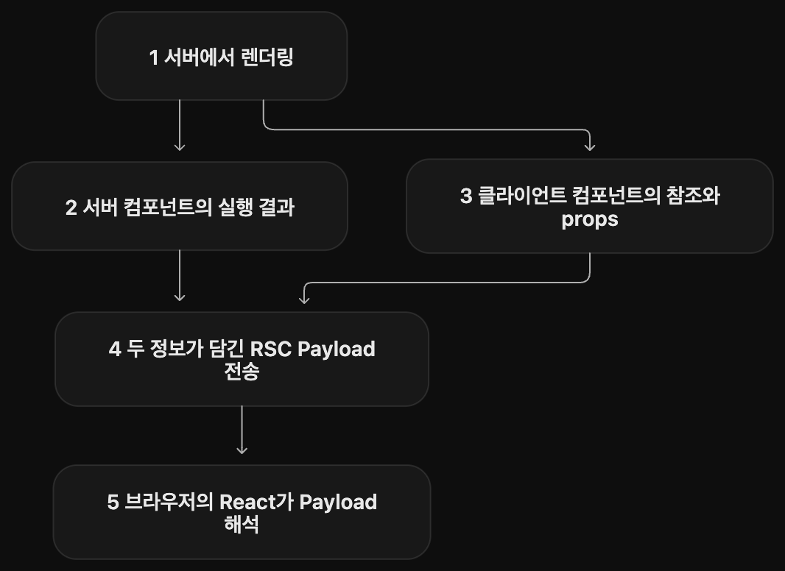

글. [Wren](/blog/authors/slamdunk11)

## 1. 인용글 정리

> What Actually Gets Sent to the Client

### 서버 컴포넌트는 실제로 브라우저에 무엇을 전달할까?

- 서버 컴포넌트가 렌더링 될 때 HTML을 생성하는 것이 아니라 RSC Payload를 생성
  - RSC Payload: 서버 컴포넌트의 렌더링 결과를 React가 읽을 수 있게 직렬화한 데이터
    - React에게 클라이언트 측 트리를 구성하는 방법을 알려주는 JSON과 유사한 명령어 스트림
    - 서버 컴포넌트가 반환한 UI 구조, 클라이언트 컴포넌트가 들어갈 위치와 JavaScript 모듈 참조, 그 컴포넌트에 전달할 props를 포함한다.

#### RSC Payload 예시(이해 돕기 위한 예시, 실제 형태는 x)

```
// app/page.tsx
import LikeButton from './LikeButton'; // 클라이언트 컴포넌트

export default function Page() { // 서버 컴포넌트
  const title = '서비스 점검 안내';

  return (
    <main>
      <h1>{title}</h1>
      <LikeButton initialCount={3} />
    </main>
  );
}
```

```
// RSC Payload
// 서버 컴포넌트인 Page 컴포넌트 내부 요소들 확인 가능
{
  type: 'main',
  children: [
    {
      type: 'h1',
      children: '서비스 점검 안내',
    },
    {
      type: 'ClientComponentReference',
      module: 'LikeButton',
      props: {
        initialCount: 3,
      },
    },
  ],
}
```

### RSC(React Server Component)의 렌더링 과정

1. React는 서버 컴포넌트를 서버에서 렌더링
2. 서버 구성 요소의 경우, 렌더링된 결과, 즉 반환된 요소가 출력되며 코드는 출력 X
3. 서버 컴포넌트 내의 클라이언트 컴포넌트의 경우, "이 컴포넌트 마운트, 해당 속성을 전달."과 같은 참조, 자리 표시자를 출력
4. 서버는 이 페이로드를 브라우저로 스트리밍(준비된 거 먼저 전달)
5. 브라우저의 React는 페이로드를 읽고 최종 트리를 구성
6. 클라이언트 구성 요소가 다운로드(클라이언트 컴포넌트 실행에 필요한 javascript 코드)되고 로드(hydration)됨, 서버 구성 요소는 이미 "렌더링"되었으므로 로드가 필요 X

#### 이 과정에서 핵심은 서버 컴포넌트의 코드는 JavaScript 번들에 포함되지 않는다는 것이다!



> Server Components can import and render Client Components, but Client Components cannot import Server Components.

### RSC 아키텍처 핵심 규칙

#### 서버 컴포넌트는 클라이언트 컴포넌트를 가져와 렌더링 가능하지만, 클라이언트 컴포넌트는 서버 컴포넌트를 가져올 수 없다!

- 클라이언트 컴포넌트가 import한 코드는 브라우저에서 실행할 코드에 포함된다.
- 서버 컴포넌트가 사용하는 서버용 DB 드라이버, 서버의 파일시스템, DB 연결 객체 등은 브라우저에 존재하지 않기 때문에 해당 코드를 가져오더라도 브라우저에서는 그대로 실행할 수 없다.
