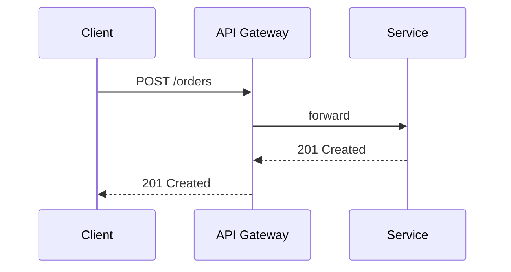

import Tabs from '@theme/Tabs';
import TabItem from '@theme/TabItem';

# Markdown 기능 모음

글을 쓸 때 자주 쓰는 기능과 실제 렌더링 결과입니다.

## 코드 블록

제목, 줄 강조, 줄 번호를 지원합니다.

```ts title="src/utils/retry.ts" showLineNumbers {3-5}
export async function retry<T>(fn: () => Promise<T>, times = 3): Promise<T> {
  for (let i = 0; ; i++) {
    try {
      return await fn();
    } catch (error) {
      if (i >= times - 1) throw error;
    }
  }
}
```

```diff
- const timeout = 1000;
+ const timeout = 3000;
```

## 탭

<Tabs groupId="lang">
  <TabItem value="java" label="Java" default>

```java
@GetMapping("/health")
public String health() {
    return "ok";
}
```

  </TabItem>
  <TabItem value="ts" label="TypeScript">

```ts
app.get('/health', (_, res) => res.send('ok'));
```

  </TabItem>
</Tabs>

## 강조 박스 (Admonitions)

:::note
일반적인 참고 사항
:::

:::tip[꿀팁]
제목을 붙일 수도 있습니다.
:::

:::info
추가 정보
:::

:::warning
주의가 필요한 내용
:::

:::danger
치명적인 실수를 막기 위한 경고
:::

## 다이어그램 (Mermaid)



## 표

| 방식 | 장점 | 단점 |
| --- | --- | --- |
| SSR | 빠른 첫 화면, SEO | 서버 부하 |
| CSR | 서버 부담 적음 | 초기 로딩 느림 |

## 인용 · 각주

> 좋은 코드는 그 자체로 최고의 문서다.

본문에 각주를 달 수 있습니다.[^1]

[^1]: 각주 내용은 글 하단에 모아서 표시됩니다.

## 더 알아보기

- [Docusaurus Markdown 기능](https://docusaurus.io/docs/markdown-features)
- [MDX 문법](https://mdxjs.com/docs/what-is-mdx/)
