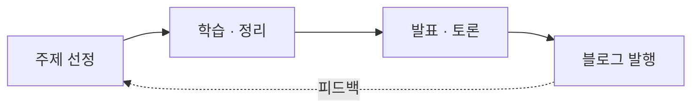

# DIDISAM Study

산타 개발자들이 관심 분야별로 함께 공부하고, 그 과정을 **스터디 노트**로 남기는 공간입니다.
완성도 있게 다듬은 글은 [블로그](/blog)에 발행합니다.

## 스터디 트랙

| 트랙 | 다루는 주제 |
| --- | --- |
| [Frontend](./frontend/index.mdx) | 웹 플랫폼, React 생태계, 렌더링 성능과 사용자 경험 |
| [Backend](./backend/index.mdx) | 서버 아키텍처, API 설계, 데이터베이스와 분산 시스템 |
| [Infra & DevOps](./infra/index.mdx) | 클라우드, 컨테이너, CI/CD, 모니터링과 운영 자동화 |
| [AI & Data](./ai/index.mdx) | LLM 활용, 데이터 파이프라인, ML 서비스 적용 사례 |
| [CS 기초](./cs/index.mdx) | 자료구조·알고리즘, 네트워크, 운영체제 등 기본기 |

## 운영 방식

1. **주제 선정** — 트랙별로 함께 파고들 주제와 자료를 정합니다.
2. **학습 · 정리** — 각자 학습한 내용을 스터디 노트로 정리합니다.
3. **발표 · 토론** — 정기 세션에서 발표하고 토론합니다.
4. **블로그 발행** — 다듬은 결과물을 블로그 글로 공개합니다.

## 스터디 노트 vs 블로그

|  | 스터디 노트 (`docs/`) | 블로그 (`blog/`) |
| --- | --- | --- |
| 성격 | 학습 과정의 기록, 계속 업데이트 | 완결된 글, 발행일 기준 |
| 구조 | 트랙 · 주제별 트리 | 시간순 · 태그별 |
| 리뷰 | 가볍게 | PR 리뷰 1명 이상 권장 |

:::tip[처음이라면]
[글쓰기 가이드](./guide/writing-blog.mdx)부터 읽어 보세요.
:::
